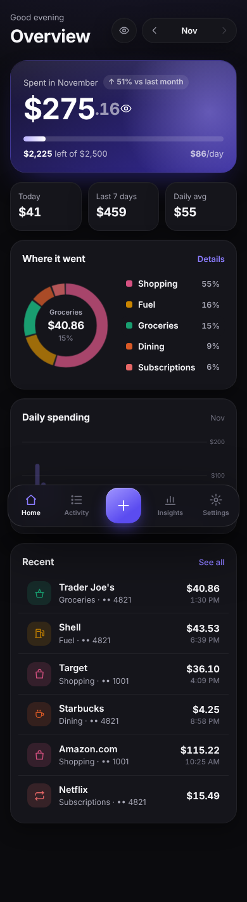
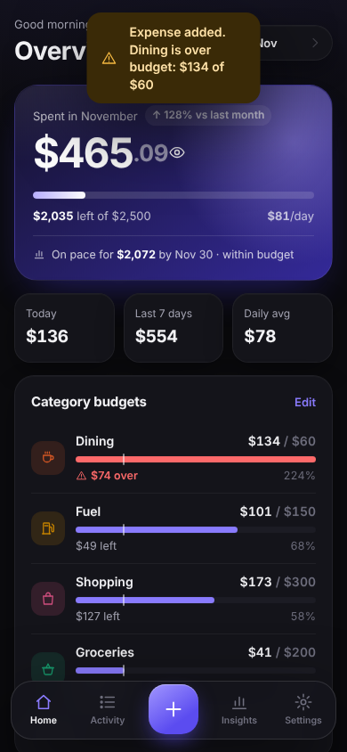
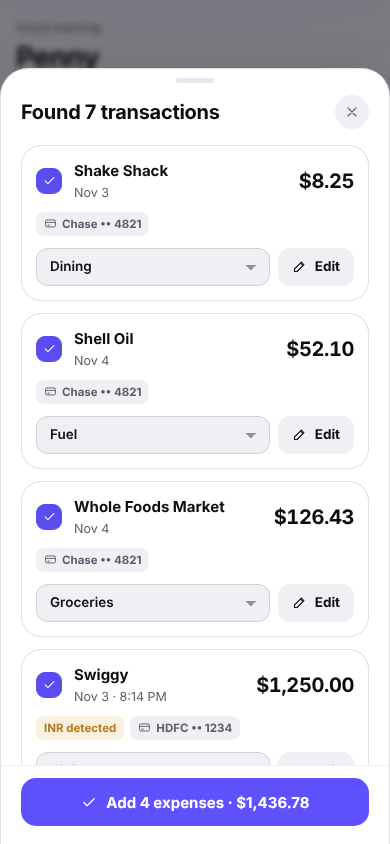
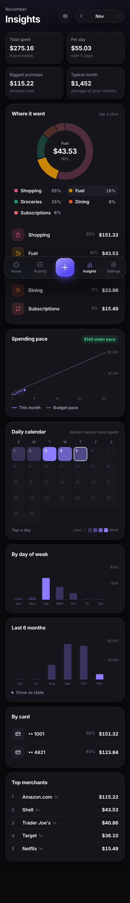

# Penny: a sleek home budget tracker

Penny tracks your daily spending without the typing. Take a screenshot of the
text or email your bank sends after each card purchase. Penny reads the amount,
merchant, date and card, suggests a category, and adds it to your budget.

Everything runs **on your device**. Screenshots are read in the browser with a
bundled OCR engine (Tesseract), and are never uploaded anywhere. Your data is
stored in the browser's local storage.

| Overview | Budgets | Review a scan | Insights |
|---|---|---|---|
|  |  |  |  |

## Features

- **Scan screenshots**: pick one or many at once. A single screenshot with
  several alerts becomes several expenses. Messaging-app headers like
  "Yesterday 7:42 PM" are used for the date when the alert itself has none.
- **Smart parsing**: picks the purchase amount and ignores "available limit" and
  "balance" figures. Flags refunds, card payments, declined charges and one-time
  codes so they are not counted as spending by mistake.
- **Duplicate guard**: an alert you already added (or two screenshots of the
  same alert) is unticked automatically.
- **Auto-categories that learn**: built-in rules for common US, UK and Indian
  merchants, and Penny remembers whatever category you choose for a merchant.
- **Log straight from bank texts**: send the alert text to Penny with a link
  (`your-penny-address/?text=...`) from an iPhone Shortcuts automation or an
  Android automation app, share an SMS to Penny on Android, or copy the message
  and tap **Paste bank text**. Turn on **Add without review** and confident
  matches are logged instantly with an Undo. Set up in Settings → Log from
  bank texts.
- **Other ways in**: paste a screenshot (Ctrl/⌘ + V), drag and drop, share a
  screenshot to the installed app on Android, or enter an expense manually.
- **Budget at a glance**: month total, budget progress, safe-to-spend per day,
  a month-end forecast, and a doughnut chart of where the money went.
- **Your month, your cycle**: set **Settings → Month starts on** to your card's
  statement day (for example the 10th) and every total, budget, forecast and
  chart follows that cycle (Nov 10 – Dec 9) instead of the calendar month.
- **Category budgets**: monthly limits per category with progress bars, a
  marker for where you'd be at an even pace, and a warning when an expense
  takes a category (or the month) past 80% or over its limit.
- **Insights**: interactive doughnut by category, spending pace against your
  budget (or last month), a daily calendar heatmap, spending by day of week,
  a 6-month trend, spending per card and top merchants.
- **Hide amounts**: tap the eye button (or the big total) to mask every amount
  with dots, for checking the app in public. Tap again to reveal.
- **Your own categories**: add categories with a name, icon and color in
  Settings → Categories, or straight from the expense editor with **New**.
- **Installable and offline**: add it to your home screen and it works offline.
- **Your data, portable**: export CSV, back up and restore JSON.
- Light and dark themes, USD / INR / EUR / GBP and more, MM/DD or DD/MM alerts.

The unit tests cover alert wording modeled on Chase, Amex, Citi, Capital One,
Bank of America, Discover, Wells Fargo, Apple Card, Monzo, HDFC, ICICI, SBI and
Axis. The parser is general enough for most "You spent X at Y" style messages,
and anything it gets wrong can be fixed on the review screen before saving.

## Run it

It is a static site with no build step and no dependencies.

```bash
npm start          # or: python3 -m http.server 8080
# open http://localhost:8080
npm test           # parser, forecast and period tests (Node 18+)
```

### Put it on your phone (GitHub Pages)

1. In the repository on GitHub, go to **Settings → Pages**.
2. Under **Build and deployment**, choose **Deploy from a branch**, pick
   `main` and the `/ (root)` folder, then **Save**.
3. After a minute or two, open **https://santoshkaruru-alt.github.io/Penny/**
   on your phone.
   - **iPhone**: Safari → Share → **Add to Home Screen**.
   - **Android**: Chrome → menu → **Install app**. You can then share a
     screenshot straight to Penny from the share sheet.

Tip: the app is served over HTTPS by Pages, which the offline mode and
install features need.

## How it works

```
index.html          app shell
css/styles.css      design tokens (light + dark), components
js/app.js           views, sheets, scanning and review flow, charts
js/parser.js        turns alert text into transactions (pure, unit-tested)
js/categories.js    categories, icons, merchant keyword rules
js/forecast.js      month-end forecast and budget thresholds (pure, unit-tested)
js/period.js        budget months: calendar or billing cycle (pure, unit-tested)
js/store.js         local-first storage, export / import
js/ocr.js           image prep (upscale, dark-mode invert, tone curve) + Tesseract
sw.js               offline cache and Android share target
vendor/tesseract/   bundled OCR engine and English model (Apache-2.0)
tests/              parser, forecast and period tests
```

## Privacy notes

- Data lives only in this browser on this device. Clearing site data erases it,
  so use **Settings → Back up** now and then.
- On iPhone, add Penny to the Home Screen; Safari may clear storage for sites
  you have not opened in a while, but Home Screen apps are kept.
